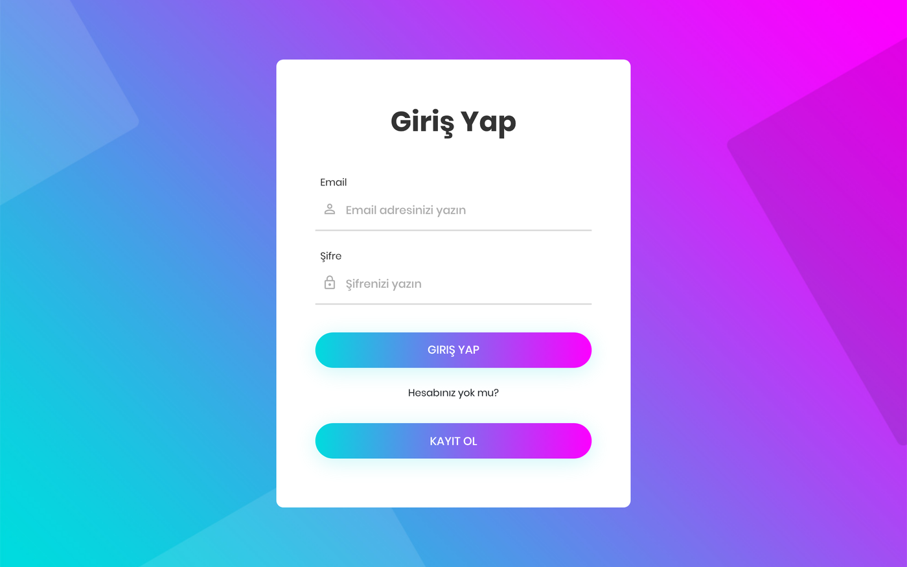
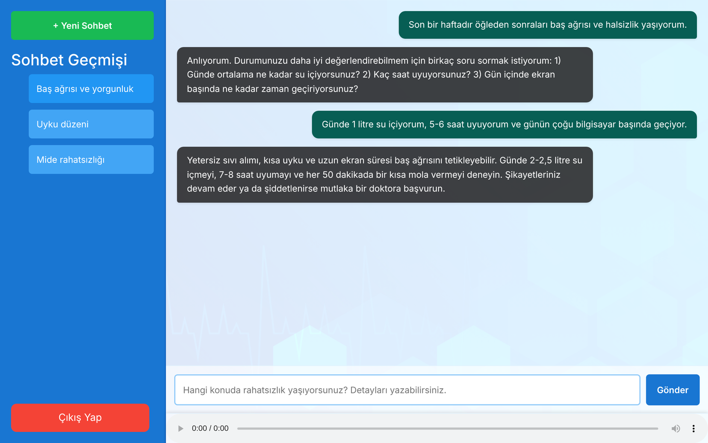
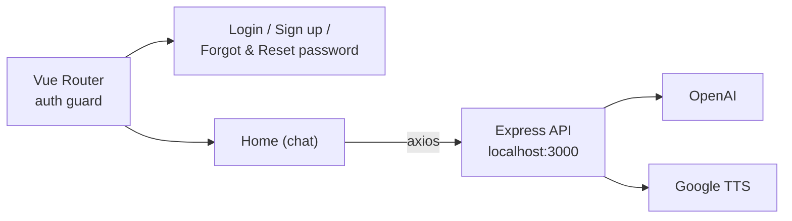

# 🩺 Digital Doctor — Web Client

> 🎓 Graduation project

The web interface of **Digital Doctor**, an AI-powered health assistant. Users sign up, describe their symptoms in a chat, answer the assistant's follow-up questions and receive health, lifestyle and nutrition advice — which they can also **listen to** as Turkish speech.

The API lives in **[digital_doctor_backend](https://github.com/Lutfu9907/digital_doctor_backend)** (Node.js, OpenAI, Google Text-to-Speech, MongoDB).

| Login | Chat |
|---|---|
|  |  |

## ✨ Features
- **Chat interface** — ChatGPT-style layout with message bubbles and a loading state while the AI answers
- **Chat history** — sidebar with previous conversations; start a new chat with one click
- **Voice answers** — each answer is converted to speech and played in the built-in audio player
- **Authentication** — sign up, login, forgot / reset password pages
- **Protected routes** — Vue Router guard verifies the JWT with the backend before opening the chat page

## 🏗️ Structure



## 🛠️ Tech Stack
Vue 3 (Composition API) · Vue Router · Pinia · Axios · Bootstrap 5 · Vite

## 🚀 Getting Started

Start the backend first, then:

```bash
npm install
npm run dev
```

Open `http://localhost:5173/login`.
